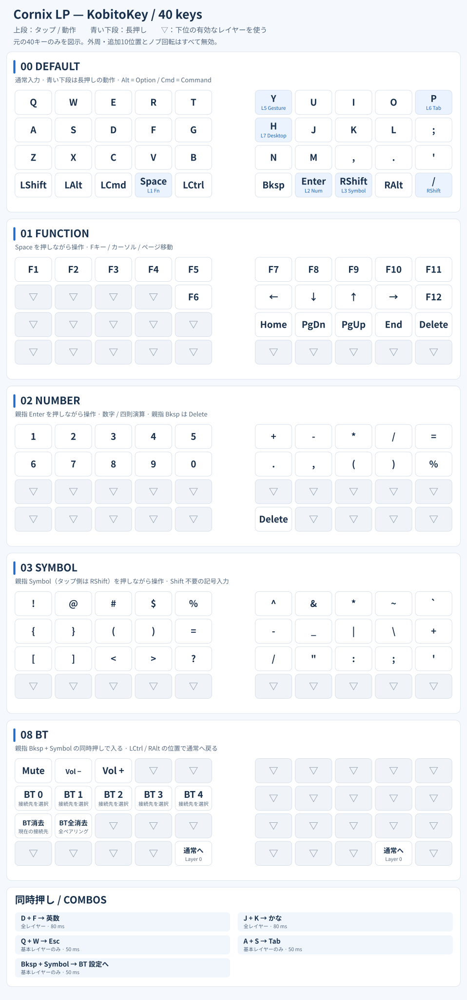
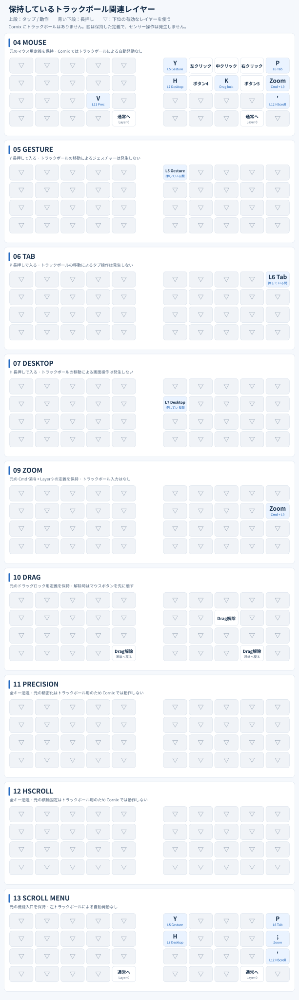

# Cornix LP — KobitoKey QWERTY / ZMK

macOS・US（ANSI）配列向けの Cornix LP 用 ZMK 設定です。
[KobitoKey_QWERTY](https://github.com/s-hiraoku/KobitoKey_QWERTY) の通常入力、
コンボ、長押し判定を Cornix の物理位置へ移植します。
**Space は左親指の中央、LCTRL はその右隣**です。

## キー配置

元の40キーだけを割り当てます。**通常・Fn・数字・記号・BT の5レイヤーと、
同時押しを1枚のSVGにまとめました。** 画像をクリックすると拡大できます。

- **キーの上段**：タップ時の入力、またはそのキーの動作。
- **青い下段**：長押し時の動作。例：`Space / L1 Fn` はタップで空白、長押しでFn。
- **灰色の下段**：動作の補足。BTの接続先選択・消去・通常へ戻るキーは、長押し不要です。
- **▽**：下位の有効なレイヤーを使う（キーの無効化ではありません）。
- **Symbol**：右親指の `RShift / L3 Symbol`。タップ側は右Shift、長押しで記号レイヤー。
  右端の `/ / RShift` は、タップで `/`、長押しで右Shiftです。
- **Alt = Option、Cmd = Command**。左Spaceだけ元の `retro-tap` を維持します。

各レイヤーは元の40キーを4行×左右5列に揃えた模式図です。
基板定義にある残り10位置（外周・追加親指位置・ノブ押し込み）は、
全14レイヤーで `&none`（無効）です。ノブ回転も無効です。

保持している残り9レイヤー（トラックボール関連）を見る

元の Layer 4〜7・9〜13 のキー定義も保持しています。
**Cornixにはトラックボールがないため、センサーによるジェスチャーや自動レイヤー切替は発生しません。**
各レイヤーの説明を図の上部に記載しています。図中の「長押し」はそのレイヤーが有効な間の動作です。

## 元設定との一致範囲

- 参照コミット: `35b175d2717d9d09373212c6f93f6aa80deb338a`。
- 元の **40 キー × 14 レイヤー = 560 bindings** を位置対応で保持。
- 5 コンボの出力・80/50ms 判定・適用レイヤーを保持。
- `lt_l` / `lt_r` / `menu_lt` 等の behavior を保持。
  `180ms` / `quick-tap-ms=125` / `require-prior-idle-ms=90`、
  左 Space だけの `retro-tap` も元の記述を使います。
- ドラッグロックと、終了時にボタンを先に離すマクロも保持。
- 元の40キー以外の10位置は全レイヤーで無効。追加の外周キー、BT/MOUSEキー、
  Studio Unlock、ノブ押し込み・回転の割り当てはありません。

**Cornix LP にトラックボールはありません。** センサードライバー、加速、精密化、
軸固定、移動によるマウスレイヤーや SCROLL MENU の自動発動は含めていません。
Layers 5/6/7/9/11/12/13 のキー定義は保持していますが、センサー由来の動作は発生しません。
Y/H/P 長押しは元と同じレイヤーに入りますが、トラックボールジェスチャーはありません。
独自の「Y+方向キーで画面操作」といった代替操作は追加していません。

Layer 4 の U/I/O の左/中/右クリック、J/L のボタン4/5、K 長押しの
ドラッグロックも定義として保持します。ただし元の入口はトラックボール操作のため、
Cornixでは自動発動しません。代替の MOUSE キーは追加しません。

## ビルドと導入

[Actions](https://github.com/s-hiraoku/cornix-keymap/actions) の **Build Cornix ZMK** が、
入力検証後に左右のファームウェアと設定リセット用 UF2 をビルドします。
ZMK と Cornix の基板モジュールは `config/west.yml` でコミットを固定しています。
ルートの `Kconfig` は、この基板モジュールの Cornix 専用ボードに対し、
新しい ZMK CI が要求する `ZMK_BOARD_COMPAT` 宣言を補います。

| ファイル | 用途 |
|---|---|
| `cornix-left.uf2` | 左・セントラル。USB、Bluetooth、ZMK Studio |
| `cornix-right.uf2` | 右・ペリフェラル |
| `cornix-reset-left.uf2` | 左の設定消去専用。通常入力用ではない |
| `cornix-reset-right.uf2` | 右の設定消去専用。通常入力用ではない |

**書き込み前に [移行・復元手順](docs/migration.md) を確認してください。**
ビルド成功は、手元の本体・ブートローダーとの適合や実機動作の確認ではありません。

## AI と設定を変更する

1. 元のキー動作を変える場合は `tests/fixtures/KobitoKey.keymap` を編集する。
   Cornix の位置対応を変える場合は `scripts/import_kobitokey.py` を編集する。
2. `python3 scripts/import_kobitokey.py` で `config/cornix.keymap` を生成する。
3. `python3 scripts/render_keymap.py` でREADME用のSVGを更新する。
4. `python3 -m unittest discover -s tests -v` で参照元・物理位置との整合を確認する。
   SVGの更新漏れは `python3 scripts/render_keymap.py --check` で確認できる。
5. Git に保存し、Actions のビルド結果を確認する。

参照 fixture はリポジトリ内に保存してあり、ビルド時に元リポジトリの main を取得しません。
意図して元のコンボ・長押し仕様を変更した場合は、該当する検証もその意図に合わせて更新します。

ZMK へ移行後、Vial/vitaly の `.vil` は ZMK には適用できません。
配置確認には [ZMK Studio](https://zmk.studio/) を使います。
元の40キーには Studio Unlock がないため、解除用のキーやコンボは追加しません。
コンボ、長押し判定、マクロはソースで管理します。
Studio の **Save** で配置を変更すると保存済み配置がソースより優先されるため、
ソース変更を反映させるときは Studio の **Restore Stock Settings** が必要です。
解除用キーが実機にない場合、保存済み配置を消すには設定リセット用 UF2 を使います。
この方法はペアリングも消すため、更新手順の注意事項を確認してください。
Studio で設定を変更していなければ、設定リセットは不要です。

## 参照

- [元の KobitoKey 設定](https://github.com/s-hiraoku/KobitoKey_QWERTY)
- [Cornix 基板モジュール・移行の注意点](https://github.com/numachang/cornix-zmk-custom/blob/ade15a303257ffb2c11357839ff39199b863b087/README_ja.md)
- [ZMK Studio の機能と保存済み配置](https://zmk.dev/docs/features/studio)
- [Cornix メーカーの標準ファームウェア](https://docs.channel.io/jezailfunderjp/ja/articles/Cornix-ファームウェア-bf1534b6)
